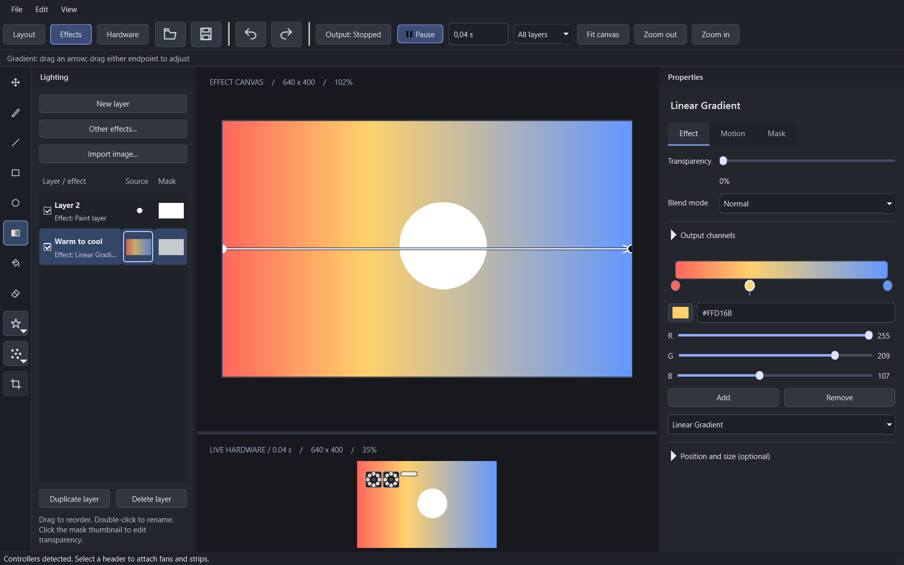

# MSI Mystic Light – Lighting Studio


A standalone Windows app for configuring and driving RGB lighting across motherboards and
peripherals, independent of MSI's own Mystic Light software. It combines a component/layout
editor, a layered effects editor and a background Windows service into one tool, and ships
with its own reverse-engineered hardware drivers rather than wrapping an existing RGB SDK.



## Features

- **Components & Layout** — arrange physical devices and LED headers spatially; a searchable
  picker supplies product categories and LED mappings; per-device LED arrangement can be
  edited independently of wire order.
- **Effects editor** — layered paint, shapes, gradients, masks, blend modes and undo/redo;
  native procedural patterns (Plasma, Kaleidoscope, Fireworks, Voronoi, DNA, and more — see
  [the effect backlog](docs/EFFECT_BACKLOG.md)) with no dependency on SignalRGB or any other
  third-party lighting app.
- **Hardware workspace** — a flat endpoint/profile/state overview with per-channel
  Stop/Resume, automatic reconnection and read-only `--scan`/`--inspect` discovery.
- **Background service** — hardware output keeps running without the editor open; see
  [service installation and limits](docs/WINDOWS_SERVICE.md).
- **Snap-to-grid, autosave/recovery, and a portable project format.**

## Supported hardware

The app loads hardware support as independent driver plugins and JSON device profiles
(see [`docs/HARDWARE_MODULES.md`](docs/HARDWARE_MODULES.md) for the module contract and how
to add a device). No vendor RGB application is required for any of these:

| Module | Devices | Hardware-confirmed? |
| --- | --- | --- |
| `msi.gen1` | MSI mainboard JARGB headers (e.g. MPG B850 Edge TI) | Yes |
| auxiliary backends | MSI I/O shield, Gigabyte AERO OC (NVAPI), ADATA XPG RAM (via PawnIO) | Yes |
| `lighting.peripherals` | Roccat Vulcan 100/120 Aimo, Roccat Kone Aimo, Razer Basilisk V3, SteelSeries Apex 3 | Not yet |
| `asrock.polychrome-usb` | ASRock Polychrome USB motherboards | Not yet |
| `lenovo.motherboard` | Lenovo motherboard RGB | Not yet |
| `hp.omen30l` | HP Omen 30L | Not yet |

"Hardware-confirmed" means the owner has observed real output on that device; everything else
is implemented and covered by software tests only. See [release notes](docs/RELEASE_NOTES_0.1.0.md)
for the detailed, current qualification status and limits.

## Getting started

Extract a Release build and run **`Install.cmd`** under `installer/` for automatic playback
(a Windows service owns hardware output; the editor runs unelevated). Or run
**`Start-Lighting.cmd`** directly for a portable run with no installation.

Useful command-line flags on `msi_mystic_light.exe`:

- `--scan` — read-only hardware/profile discovery, no device is opened.
- `--inspect` — validate local module/component catalogs without starting the UI.
- `--component-dir` / `--module-dir` — point at an alternate local catalog.
- `--editor` — skip the startup "competing RGB process" dialog; output still starts automatically.

The binaries are currently unsigned (no SignPath or code-signing claim).

## Building from source

Requires an x64 Visual Studio developer prompt, CMake, Ninja, a Qt 6.2+ installation
(Widgets, Svg, Network, Test; see `CMakeLists.txt`), and hidapi.

```bat
cmake -S . -B build -G Ninja -DCMAKE_BUILD_TYPE=Release -DCMAKE_PREFIX_PATH=C:/Qt/6.8.3/msvc2022_64
cmake --build build
ctest --test-dir build --output-on-failure
```

If hidapi isn't on CMake's search path, add `-Dhidapi_ROOT=C:/path/to/hidapi-sdk` (the directory
must contain `include/hidapi.h` and `lib/hidapi.lib`), or install it via vcpkg and pass
`-DCMAKE_TOOLCHAIN_FILE=<vcpkg>/scripts/buildsystems/vcpkg.cmake`.

The build also needs matching Release and Debug WebP image-format plugins
(`qwebp(d).dll`). If your Qt install already includes the ImageFormats addon, nothing further
is needed; otherwise run `tools/build-webp.ps1` once to build them from the pinned Qt
ImageFormats source — see [third-party notices](THIRD_PARTY_NOTICES.md) for details. RAM
lighting additionally needs the separately installed official [PawnIO](https://pawnio.eu) 2.x
runtime; see `third_party/pawnio/README.md`.

`.github/workflows/ci.yml` builds the project and runs the full hardware-free CTest suite on
every push; see [`CONTINUE.md`](CONTINUE.md) for current implementation status and the
hardware-qualification log, which stays separate from automated CI.

To package a portable release archive: `python scripts/package_release.py` (see
[release notes](docs/RELEASE_NOTES_0.1.0.md)).

## Documentation

**Editor & hardware**
- [`docs/LIGHTING_EDITOR.md`](docs/LIGHTING_EDITOR.md) — editor controls, navigation and identity.
- [`docs/HARDWARE_MODULES.md`](docs/HARDWARE_MODULES.md) — driver plugin contract and profile schema.
- [`docs/OUTPUT_SESSION.md`](docs/OUTPUT_SESSION.md) / [`docs/WINDOWS_SERVICE.md`](docs/WINDOWS_SERVICE.md) — output scheduling and the background service.
- [`docs/EFFECT_BACKLOG.md`](docs/EFFECT_BACKLOG.md) — implemented and planned effects.
- [`docs/HARDWARE_SUPPORT_STRATEGY.md`](docs/HARDWARE_SUPPORT_STRATEGY.md) — policy for adding new hardware.
- [`docs/HP_OMEN_MIGRATION.md`](docs/HP_OMEN_MIGRATION.md) — first independent (non-OpenRGB-derived) driver module.
- [`docs/hardware-inventory/README.md`](docs/hardware-inventory/README.md) — OpenRGB/SignalRGB device inventory used to plan new modules.

**Architecture & vendor-protocol research** (no vendor code included — behavior is described
in our own words; see the notice in [`docs/ARCHITECTURE.md`](docs/ARCHITECTURE.md))
- [`docs/ARCHITECTURE.md`](docs/ARCHITECTURE.md) — MSI Mystic Light's own architecture (service, DLLs).
- [`docs/NETWORK_PROTOCOL.md`](docs/NETWORK_PROTOCOL.md) — its local network interfaces.
- [`docs/MB_800_HID_PROTOCOL.md`](docs/MB_800_HID_PROTOCOL.md) — the "800-series" mainboard USB HID protocol.
- [`docs/SIGNALRGB_REPOSITORY_RESEARCH.md`](docs/SIGNALRGB_REPOSITORY_RESEARCH.md), [`docs/SIGNALRGB_TOPIC_RESEARCH.md`](docs/SIGNALRGB_TOPIC_RESEARCH.md), [`docs/SIGNALFORGE_EDITOR_RESEARCH.md`](docs/SIGNALFORGE_EDITOR_RESEARCH.md) — public SignalRGB research used for comparison and editor design.
- [`docs/OPENRGB_UPSTREAM_DRAFT.md`](docs/OPENRGB_UPSTREAM_DRAFT.md) — draft comment for OpenRGB issues #4935/#5429 (not posted).

## Related repos

Part of a local repo cluster under `Software_Projects/`:

- `../OpenRGB/OpenRGB` — our own OpenRGB fork with `MSIMysticLight290Controller`.
- `../OpenRGB/OpenRGBResearch` — raw packet captures and analysis scripts.

## License

Original project code is licensed under GPL-2.0-or-later; see [LICENSE](LICENSE). Qt and other
bundled components remain under their own licenses; see
[third-party notices](THIRD_PARTY_NOTICES.md). Research documents describe vendor behavior in
our own words and do not relicense or include vendor software.
