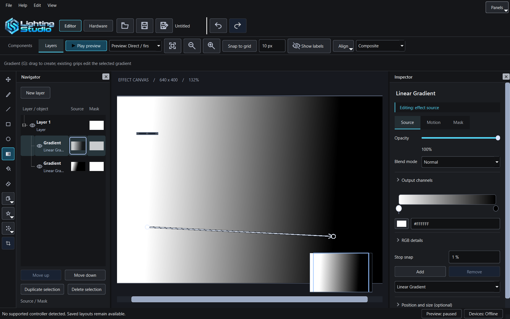

# MSI Mystic Light - Lighting Studio

A standalone Windows lighting application with a unified component and effect editor. Configure supported controllers/channels, arrange physical component
geometry and create layered software effects with masks and live output.
The current native module is msi.gen1 with an explicit B850 Edge TI board profile;
physical-device qualification remains separate from software regression tests.

This repository also contains reverse-engineering notes on MSI Mystic Light.
No vendor code is included: decompiled source stays in local scratch directories;
research documents describe behavior and byte layouts in our own words.

## Contents

- [`CONTINUE.md`](CONTINUE.md) — implementation status, validation, and next steps.
- [`docs/SIGNALRGB_REPOSITORY_RESEARCH.md`](docs/SIGNALRGB_REPOSITORY_RESEARCH.md) — pinned public-repository research on components, plugins, add-ons, and MSI discovery.

The gaming-oriented workspace uses graphite surfaces with cyan accents.
Panels can collapse for more canvas space; playback and device-output status remain separate.



## Standalone app implementation

The app now loads local driver plugins and independent device profiles; see
[`docs/HARDWARE_MODULES.md`](docs/HARDWARE_MODULES.md) for the module contract,
adding hardware support, profile schema, and current limitations. The first
module is `msi.gen1`, with an explicit B850 Edge TI board profile.
Data-only component definitions and validated channel-chain mappings are also
implemented. The bundled generic 8-LED strip demonstrates adding a product
without changing a driver. Use `--component-dir` for another local catalog;
repository downloads remain separate work. Components and Layers share one Editor workspace,
with component authoring, layered effects, soft masks, transparency and blend modes,
undo/redo, portable projects, per-layer channel targets and independent channel clocks.
The app opens in Editor with Components selected and lists supported controllers and their headers.
Hardware has its own workspace for attachment, component definitions and output,
with the same selectable header/component overview as Layout and Add/Remove actions.
Its searchable picker supplies product categories, quantities and physical LED mappings. Header groups and individual components can be arranged independently.
Effects has standard drawing tools: pencil, line, rectangle, ellipse, gradient,
fill, eraser and move/crop. New layer creates an empty layer; toolbar flyouts add shapes, generators and images;
Shapes and Particles are direct toolbar menus. The gradient tool draws editable gradients. Composite shows sampled component lighting while authoring; an optional split preview is available in View. Particle motion patterns share one
Source inspector. Gradients have movable color stops, optional RGB details and Add/Remove.
A shared live HSV color picker supports Hex, recent colors, eyedropper, cancellation and undo.
Integer display units preserve exact existing project values; Motion changes only the selected
layer until Apply motion to all visible layers is explicitly used. The selected Lighting Studio
identity appears in the application toolbar. The full conceptual banner remains in About.
Layout again shows the running effect behind component groups, with visible group
boundaries, corner resize and rotation handles. Zoom in/out and Fit are explicit.
Gradient arrows remain editable after drawing; the fill tool handles connected
paint areas while preserving antialiased edges. Gradient fills recolor painted coverage
or procedural shapes without replacing their geometry. Palette animation supports paint;
Apply motion to all visible layers is an explicit action. Travelling gradients
use a closed color cycle in the arrow direction, avoiding canvas-edge seams.
Starting animated hardware output resumes paused playback.

The restored peripheral module detects Roccat Vulcan 100/120 Aimo, Roccat Kone Aimo,
Razer Basilisk V3 and SteelSeries Apex 3, with dedicated keyboard/mouse geometry.
Output reports and Vulcan's paired interfaces use the same automatic connection
and stop/fault pipeline as the motherboard. API 2 modules require the extended
output-report transport; API 1 feature-report modules remain compatible.

A new session can restore hardware chains from the original Lighting Studio
settings without editing that file. Hardware also offers an explicit import.
This imports geometry, wire order and supported native commands; **old custom
effect recipes are not converted**. Existing projects and assignments take precedence.
Actual device lighting/color calibration still needs physical confirmation.

See the [complete workspace](docs/images/studio-workspace.png),
[hardware picker](docs/images/hardware-picker.png), [Hardware workspace](docs/images/hardware-workspace.png), and [header layout](docs/images/header-layout.png),
[editor documentation](docs/LIGHTING_EDITOR.md) and [design review](docs/EDITOR_DESIGN_REVIEW.md).

Start **`Start-Lighting.cmd`**. It prefers the prepared `build/dist/LightingStudio-Hotfix/`
application folder and falls back to `build/ninja/Release/` for development builds.
Close an already running instance after saving before starting an updated build.
The old `build/ninja/msi_mystic_light.exe` is not the supported entry point.
Keep the entire Release folder together: `hidapi.dll`, Qt DLLs, plugins and catalogs
are runtime dependencies. A missing `hidapi.dll` means the runtime folder is incomplete;
rebuild/copy the full folder. Do not download unrelated DLLs. See `PORTABLE_README.txt`.

Canvas output starts automatically for configured, detected hardware. Hardware has
**Stop output** and **Resume output**, with no report-consent dialog. Endpoint/profile
identity and serialized reports are still validated before opening HID. Changed
channel configurations reconnect automatically; offline saved devices do not block
present headers. Hardware Stop pauses the selected output until Resume or the next app launch;
tray Stop stops all connections and automatic retries.
MSI configuration writes contain all 18 zones; unassigned firmware settings are not
read back or preserved. Stop holds the last state. See [output](docs/OUTPUT_SESSION.md).
Autosave/recovery, last-project/window restoration and a tray menu are implemented.
`--editor` skips only the startup conflict dialog; configured output remains automatic.
`--inspect` validates local catalogs and `--scan` performs read-only discovery.
Hardware regression tests do not establish physical color calibration; the user has confirmed RAM Canvas output.

Build from an x64 Visual Studio developer prompt with CMake, Ninja, and a
shared Qt6 installation available, including the Qt SVG module (adjust the Qt path
for your machine).
Windows builds require matching Release and Debug WebP image plugins. If Qt
ImageFormats is installed with the SDK, skip the build-webp command below.
Otherwise the script downloads the pinned, unmodified Qt ImageFormats 6.8.3
source into ignored build directories and builds both plugins. The current
fallback is specifically for Qt 6.8.3; use matching SDK plugins for other Qt versions:

```bat
set "PATH=C:\Qt\6.8.3\msvc2022_64\bin;%PATH%"
powershell -NoProfile -ExecutionPolicy Bypass -File tools/build-webp.ps1 -QtPrefix C:/Qt/6.8.3/msvc2022_64
cmake -S . -B build/ninja -G Ninja -DCMAKE_BUILD_TYPE=Release -DCMAKE_PREFIX_PATH=C:/Qt/6.8.3/msvc2022_64
cmake --build build/ninja
ctest --test-dir build/ninja --output-on-failure
```

The HID transport library and test fake are implemented separately from the
application. Transport tests replace HIDAPI functions at link time, covering
initialization failure, failed opens, repeated close/reopen, invalid buffers,
short writes, and multiple wrapper lifetimes without touching hardware.
The app links HIDAPI for descriptor enumeration and explicitly authorized output.

HIDAPI headers and a library are now required to build the transport. If they
are not on CMake's search path, add `-Dhidapi_ROOT=C:/path/to/hidapi-sdk`
to the configure command; the root should contain `include/hidapi.h` and
`lib/hidapi.lib` (or `x64/hidapi.lib` on Windows). The validated local SDK is
the existing `../OpenRGB/OpenRGB/dependencies/hidapi-win` directory; no
OpenRGB application code is linked. Qualified protocol adapters retain their
OpenRGB provenance; no external RGB application is required. RAM uses the separately installed official PawnIO 2.x runtime. The Windows build copies the matching HIDAPI DLL beside the executable. Qt must remain dynamically linked.

Original project code is licensed under GPL-2.0-or-later; see [LICENSE](LICENSE).
Qt remains under its own license; see [third-party notices](THIRD_PARTY_NOTICES.md) for the WebP plugin source, build/replacement instructions and license texts. Research references do not relicense vendor
software or include it in this project.

## Research documents

- [`docs/ARCHITECTURE.md`](docs/ARCHITECTURE.md) — overall architecture:
  Windows service, LEDKeeper2.exe, MysticLight_AllDevice.dll, MLModule.dll,
  SyncData.dll.
- [`docs/NETWORK_PROTOCOL.md`](docs/NETWORK_PROTOCOL.md) — local network
  interfaces (HTTP SDK, UDP pairing/sync, SignalRGB UDP bridge).
- [`docs/MB_800_HID_PROTOCOL.md`](docs/MB_800_HID_PROTOCOL.md) — USB HID
  protocol of the "800-series" mainboard generation (VID `0x0DB0`/PID
  `0x0076`, report `0x50`/`0x51`/Gen2) — counterpart/correction to
  `OpenRGBResearch/msi-b850/PROTOCOL_NOTES.md`.
- [`docs/OPENRGB_UPSTREAM_DRAFT.md`](docs/OPENRGB_UPSTREAM_DRAFT.md) — draft
  comment for the OpenRGB issues #4935/#5429. **Not posted yet, local draft
  only.**

## Related repos

Part of a repo cluster under `Software_Projects/` (see also
`OpenRGB/OpenRGBResearch/CONTINUE.md`):

- `../OpenRGB/OpenRGB` — our own OpenRGB fork with `MSIMysticLight290Controller`
- `../OpenRGB/OpenRGBResearch` — raw packet captures, analysis scripts

Editor design reference: [SignalForge review](docs/SIGNALFORGE_EDITOR_RESEARCH.md).

Use `--scan` to list HID endpoints, system board identity and matching device
profile candidates. This is read-only discovery: no device handles are opened
and no lighting reports are sent. Ambiguous candidates remain unselected.

Additional references: [SignalRGB GitHub topic triage](docs/SIGNALRGB_TOPIC_RESEARCH.md).

Normal startup now checks known competing RGB processes and offers Terminate all,
selected Terminate, Ignore and Cancel. No process is stopped automatically.
After force-stop, the dialog waits asynchronously for the original process identities
to disappear (up to two additional seconds). A second click is not needed to confirm
normal delayed exit. Restarted replacements stay listed and require another explicit
action; a timeout or scan failure remains visible.
Service-owned helpers require manual shutdown. Use `--inspect` for catalog-only
validation; `--scan` remains read-only and bypasses this pre-connection gate.
Windows builds include the required Qt DLLs and Windows platform plugin beside
the executable; a packaged installer is not implemented yet.

### Per-device LED arrangement

Select an individual component in Layout or Hardware and choose **Edit LED arrangement**.
The **Arrange LEDs** menu provides Line, Circle, Ellipse and Rectangle templates;
drag individual numbered LEDs to refine their positions, use the wheel to zoom,
and **Fit LEDs** to frame the result. **Reset arrangement** restores the geometry
from when the dialog opened. Cancel discards changes.

This action changes only the selected device. LED count and physical wire order
stay locked; sampling and hardware output use the new positions with the original
wire mapping. Apply is one undo step and the arrangement is embedded in saved
projects. Shared definition authoring remains under Hardware's custom component
definitions. Device geometry uses a private embedded definition and counts toward
the existing 256-definition project limit.

Layout movement samples the live canvas during dragging, before the single undoable
commit. Click a component to select it independently; drag a header label to move
its group. Hardware keeps the header/component inventory on the left and a flat
Endpoint / Profile / State table on the right,
with selection-scoped Stop/Resume and an expanding status list. Play preview / Pause preview
controls shared animation playback; Hardware remains the navigation action.

IOShield Canvas and RTX 5080 AERO OC lighting restore the original shared-color
`0x50` fallback and qualified NVAPI path. RAM now uses PawnIO directly, with the
signed AMD SMBus module and an exact ENE firmware/eight-LED handshake at 0x71/0x73.
Install official PawnIO 2.x from https://pawnio.eu, run Lighting Studio as administrator, then use Hardware > Refresh.
No OpenRGB process or network helper is used. The user confirmed physical RAM Canvas
output with the diagnostic build; automated register checks alone are not physical-output proof.
See third_party/pawnio/README.md for scope and prerequisites.

Layout includes a fullscreen canvas and click/drag minimap. Its world bounds grow
with hardware placements beyond the original area, including negative coordinates.
The Effects raster stays 640x400 and maps across those Layout bounds for both live
preview and hardware sampling. Play preview / Pause preview controls the shared animation
clock; the separate Preview and Devices status chips remain visible in the status bar.

Snap to grid is enabled by default for spatial editing. The toolbar toggle and
1–100 px spacing apply to Layout, Effects and the LED arrangement editor. Hold
Alt for free placement; Ctrl+Shift+G toggles snapping even in fullscreen. Groups
and selected LEDs move by a shared snapped delta, preserving their internal
offsets and wire order. Drawing/gradient endpoints and resize handles snap in
world coordinates; rotation snaps to 15 degrees. Freehand brushes, erasing, fill,
camera navigation and explicitly entered numeric coordinates remain precise.
Gradient palette stops use the same spacing number as a percentage (10 = 10%).
Grid preferences are stored outside projects; opening a project does not resnap it.

Documentation screenshots must come from a native Windows `test_editor` run
(`QT_QPA_PLATFORM=windows`). Run `python scripts/update_doc_screenshots.py` after
the test, then visually inspect the images before publishing. Test artifacts are
separated by Qt platform; promotion rejects offscreen renders, missing Latin
glyphs, and incomplete image sets. Run the promotion checks with
`python -m unittest discover -s tests/docs -v`.

## Preparing a Windows release

Build and test both Release and Debug using the build instructions above. With
Python 3 installed, CTest also runs the package/screenshot regression checks.
Create the portable archive with `python scripts/package_release.py` (use
`--runtime` for a different Release output directory). The default output is
`build/dist/MSI-Mystic-Light-0.1.0-windows-x64.zip`, with an adjacent SHA-256 file.
Packaging validates required DLLs, includes source catalogs and license notices,
and excludes personal projects and stale build catalogs. Extract the whole ZIP
to a new folder; do not merge it into an older installation.

See [release notes](docs/RELEASE_NOTES_0.1.0.md) for supported hardware and limitations.
The application is currently unsigned; no SignPath acceptance or signing is claimed.

Canvas navigation uses protected header margins, overflow-only scrollbars/minimap,
and edge scrolling while dragging Layout hardware. Hardware selection includes
manufacturer/category filters. Open/Save/Save as display the active project filename.
See [editor navigation and identity](docs/LIGHTING_EDITOR.md#workspace-navigation-and-catalog-identity).

Local development builds use a stable portable path,
`build/dist/LightingStudio-Unified/msi_mystic_light.exe`, launched by `Start-Lighting.cmd`.
The current development archive is `build/dist/LightingStudio-Unified-windows-x64.zip`;
it is separate from the published versioned release archive. Build logs are grouped
under `build/logs`; retained diagnostics and archived transient helpers are under
`build/research`. The active build trees remain `build/next` (Release) and
`build/multi` (Debug).


The unified Editor combines component arrangement and effect authoring. Components and Layers choose the editing target; Composite, Effect only and Components only choose the view. Multiple editable objects share each layer. New layer creates
an empty container; toolbar flyouts add content. G creates new gradient objects; visible endpoint grips edit existing gradients. Shapes choose Solid or Gradient fill without replacing geometry. Channel preview selection stays stable while editing, and
per-frame caching shares equivalent output compositions. Output status separates
active, paused and failed channels, with details in Hardware. Project schema 14
preserves older source IDs and values when loading; older editor versions cannot
read newly saved files. See [unified editor controls and compatibility](docs/design/UNIFIED_EDITOR_IMPLEMENTATION_2026-10-27.md).

Shift-click and marquee select multiple objects. Align supports selection bounds and distribution; smart guides and grid snapping respect Alt bypass. View offers editing locks, saved in schema 14. Hold L to reveal component labels; Line uses I. Split hardware preview is optional.
