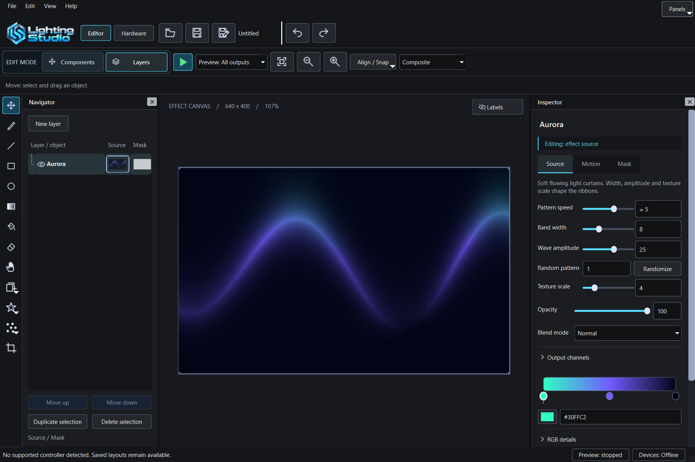
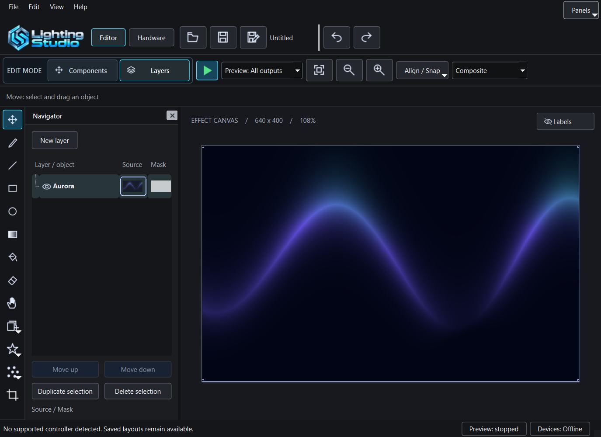
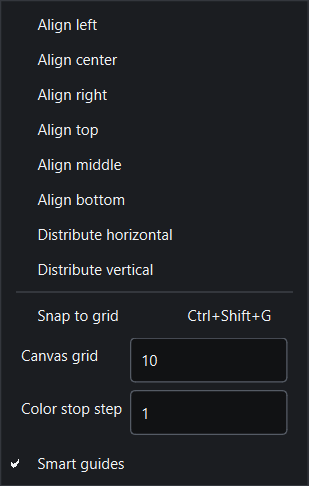
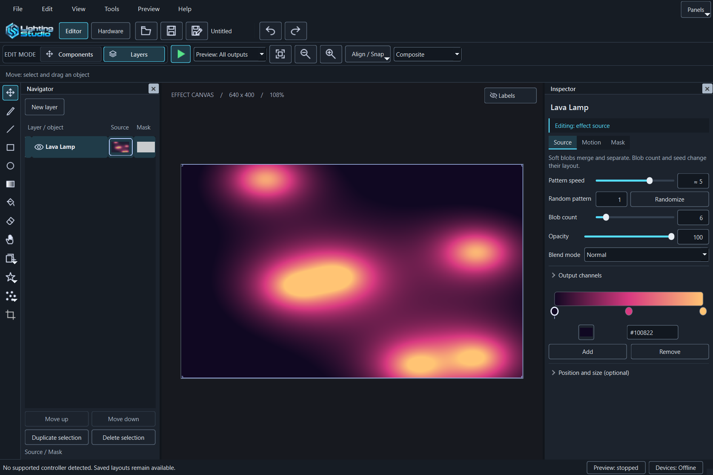
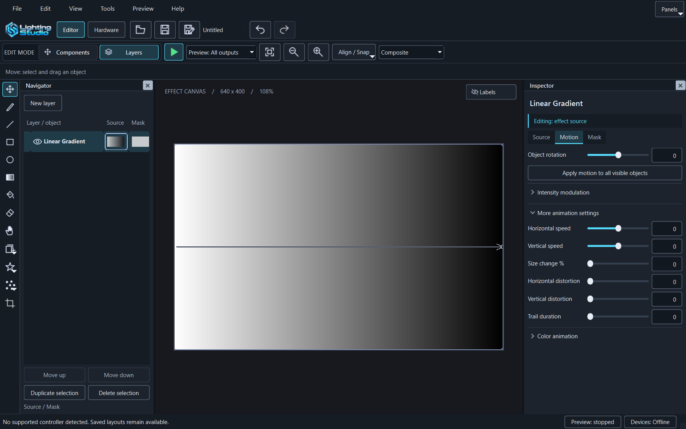
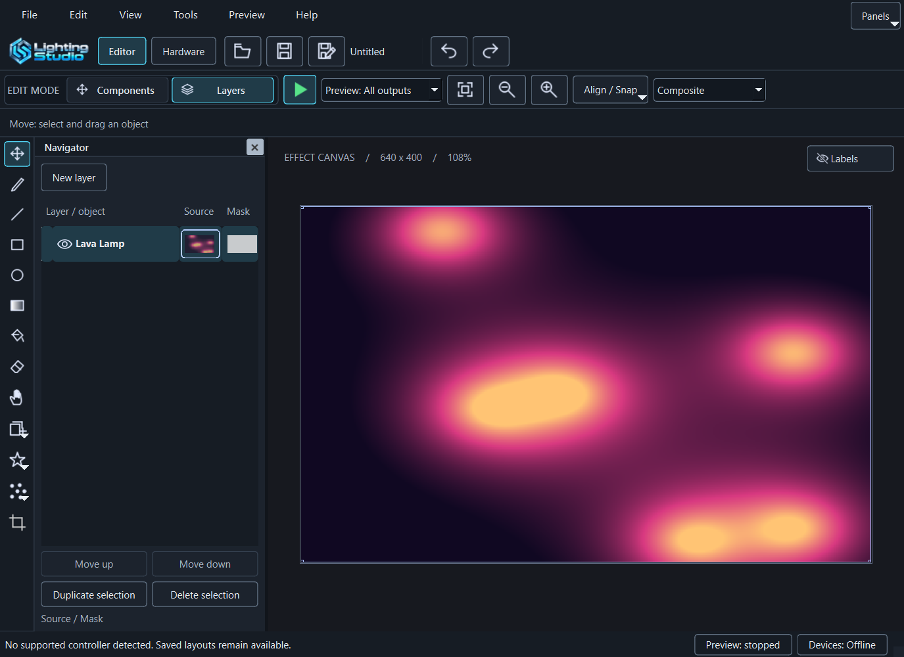

# Lighting Studio editor UX review

## Direction and scope

The editor answers: what lighting does the selected source create, and how can it
be placed precisely on real components? The canvas is the largest element. Quiet
dark chrome and the existing Lighting Studio identity stay; lighting, selection
and actual output status carry color. No decorative motion or new UI dependency.

The app-screen design draw selected Data terminal, seed 180975419, retaining the
existing palette and system typography. Its restrained selection treatment is
adapted to native Qt/Windows. Browser/phone layouts and web CSS inspectors are
not evidence for this application; validation uses native Qt screenshots and tests.
Desktop HIG principles, design tokens, icon consistency, interaction engineering,
accessibility and motion review informed the following changes. Banner, logo and
slide workflows do not apply to the editor's controls.

## Findings and implementation

| Before | After | Why |
| --- | --- | --- |
| Pan indexed an eight-item tool-hint list as the ninth tool | Explicit Pan hint and bounded lookup; brush controls hidden | Reproduced Debug QList range failure after Pan plus property refresh |
| Text Hand button outside the exclusive tool group | Consistent outline icon, 36-square target, exclusive checked state, H shortcut, accessible name | Visible state matches the active tool |
| Snapping in toolbar, palettes and Align | One Align / Snap menu with grid toggle, canvas spacing, color step and guides | Settings belong to precision tools, not effect parameters |
| Space remained held after focus moved elsewhere | Clear temporary Pan on focus loss/hide | Release can go to a different window |
| Pan consumed minimap clicks | Minimap navigation has priority | Tool selection must not break navigation |
| Global screen anchor copied from an invisible startup page | Fit before first visible layout; preserve screen anchor only for visible mode switches | Prevents a valid source being placed outside the view |
| Gradient direction arrow on procedural fields | Move shows transform grips; explicit Gradient tool retains endpoint editing | Avoids a misleading, oversized guide |
| Opacity number below its slider | Editable number beside slider, linked through existing undo path | Precision without an extra row |
| Effect rate below compositing/palette controls | Source description and core pattern controls first | Frequent edits stay near the top |
| Narrow layer names and large hierarchy indent | Wider initial navigator, smaller indent and thumbnails | Recognizable layer names |
| Color point movement required dragging | Ctrl+arrows uses color step; Ctrl+Alt+arrows moves finely | Keyboard alternative; plain arrows still select stops |
| Generic source menu labels | Organic/noise and scene groups; descriptive source metadata | Clear placement and discovery |
| Restored hidden panels reopened on mode changes | Explicit panel preferences survive restart and temporary Hardware/compact hiding | Keep user choices separate from automatic visibility |
| Panels button exposed the whole View menu | Panels menu contains panels and workspace reset | Menu title matches its contents |
| Large tool help row and heavy mode borders | Smaller stable help row and thinner selection borders | More room for the canvas; no tool-switch layout jump |
| Alignment actions looked available for one item | Alignment needs two selected objects; distribution needs three | Disabled state reflects whether an action can work |
| Toolbar keyboard focus blended into chrome | Explicit rail focus outline, accessible names, native focus semantics | Pointer and keyboard remain usable |

Existing disclosure motion stays brief, interruptible and disabled for keyboard
activation/reduced-motion preferences. Play/Stop colors and output-state separation
are retained. Project editing, undo, masks, device routing and recovery are preserved.

## Additional procedural sources

Aurora uses coherent-noise light curtains; Lava Lamp uses seeded moving metaballs;
Checkerboard scrolls a cell grid; Kaleidoscope mirrors radial sine fields. Each is
an independent root source and reuses palettes, geometry, masks, blending and
absolute-time evaluation. Organic/noise contains Aurora and Lava Lamp; gradients
and patterns contains Checkerboard and Kaleidoscope. No upstream scripts/assets
are imported and full upstream option parity is not claimed.

Schema 19 adds their source IDs. Existing schemas retain defaults and are readable;
old-schema files carrying new IDs reject atomically. Source descriptions and reset
defaults share effect metadata. Aurora noise advances continuously rather than
repeating an identical short loop. Lava uses a bounded site count without simulation
state, keeping seeks deterministic.

## Crash evidence and validation boundaries

Windows Application events 1000/1001 recorded the portable editor crashing at
2026-10-28 19:57:01 with c0000005 in VCRUNTIME140.dll. A local minidump exists; its
stack was not decoded. The specific Pan/property-refresh path was independently
reproduced in Debug as QList::at index out of range before the fix. Release also
returned the wrong hint. This proves the corrected mechanism, not that every
possible cause of the user's crash has been excluded.

Native test captures cover the primary and compact editor, the Align / Snap menu,
and the procedural gallery. Focused tests cover Pan refresh, exclusive selection,
hidden stroke controls, focus-loss recovery, minimap navigation, palette keyboard
movement, opacity edits/undo and startup visibility. Source tests cover animation,
freeze/seek, defaults, validation and save/load. Final gate results are recorded in
CONTINUE.md. Physical hardware and screen-reader runtime are separate checks.

## Captures and measured checks

Measured sRGB contrast: primary text #f1f3f5 on #1b1d21 is 15.17:1; muted text
#afb4bd on #1b1d21 is 8.11:1; focus accent #55deff on #151619 is 11.44:1.
Normal text exceeds 4.5:1. A QT_SCALE_FACTOR=1.5 native run passed the design,
Pan and Hue regressions; Windows constrained the oversized test window to the
monitor, so this is not an unconstrained multi-monitor/DPI migration test.

Release CTest passed 19/19; full native Windows editor passed 136/136 with no
skips. Debug CTest passed 19/19; package inspection and simulation-host smoke passed. Final deployment hashes are recorded in CONTINUE.md.

## Unified color entry follow-up

The picker exposes HSB, RGB and hexadecimal values together. Numeric channels commit
on Return or focus change so HSV/RGB synchronization cannot rewrite intermediate
keystrokes. Hue accepts 360 as equivalent to zero. Radar intrinsic rotation and
object rotation use distinct labels. The split-region and unified-selection redesign
is still pending; these changes do not implement that workflow.

The palette inspector no longer duplicates RGB channel sliders. Its selected-stop
swatch opens the shared HSB/RGB/Hex picker. Inline hexadecimal inputs use a common
104 logical-pixel width and swatch buttons use 32 by 32 logical pixels.

## Gaming-Pro-Studio refinement

The owner-selected direction is a restrained gaming creative workspace, not a
website, a macOS imitation or a neon HUD. The extracted Lighting Studio wordmark
carries the identity; the scenic banner remains in About. Navy/graphite chrome
stays distinct from the lighting content. This refinement uses ui-ux-pro-max,
apple-hig-review, design-system and emil-design-eng. The design-system search
returned generic marketing layouts rather than a verified desktop-editor match;
those layouts, purple/rose palette and web animation advice were not adopted.

| Before | After | Why |
| --- | --- | --- |
| Per-range numeric widths and competing 80/88/96 px constraints | Shared 64-DIP baseline, font-aware uniform scaling, right-aligned digits | Compact, stable number columns without changing saved precision |
| Taller branding, tabs and panel padding | Smaller wordmark, 8-DIP panel padding, 6-DIP form gaps, shorter tabs/disclosures and 32-DIP tool targets | More useful canvas and inspector space without shrinking the system font |
| Cyan on ordinary hover as well as selection | Neutral navy hover, cyan focus/selection and semantic device status colors | Keep lighting content dominant and distinguish active state |
| Pointer-led panel access | F6/Shift+F6 cycling visible editor panels; Tools/Preview/View menu equivalents | Predictable keyboard navigation and access when toolbar widgets overflow |
| Independent Motion form label widths | Common label column and shared numeric width | Aligned sliders across related settings |

The small semantic palette is in `src/editor/StudioTheme.h`. Measured sRGB
contrast is 13.41:1 for #E7EDF3 text on #1C232D panels, 7.83:1 for #AAB8C8
secondary text on that surface, 11.28:1 for #55DEFF focus on #121820 inputs,
and 3.57:1 for #617183 control borders on those inputs. Measurements do not
constitute a screen-reader or Windows contrast-theme certification.

### Creative-software research

- [Krita navigation and dockers](https://docs.krita.org/en/user_manual/getting_started/navigation.html): toolbox, tool options and docked task panels.
- [Photoshop workspace](https://helpx.adobe.com/photoshop/desktop/get-started/learn-the-basics/workspace-overview.html) and [contextual task bar](https://helpx.adobe.com/photoshop/desktop/get-started/learn-the-basics/boost-workflows-with-the-contextual-task-bar.html): selection-dependent actions, with stable context options retained here rather than another floating overlay.
- [Premiere panel navigation](https://helpx.adobe.com/premiere/desktop/get-started/tour-the-workspace/navigate-the-panels.html): keyboard routes between panels and separation of playback from editing.
- [GIMP dialogs and docking](https://docs.gimp.org/3.2/en/gimp-concepts-docks.html): persistent task panels and recovery through window menus.
- [CorelDRAW property docker](https://product.corel.com/help/CorelDRAW/Documentation-Windows/CorelDRAW-en/CorelDRAW-Modify-objects-with-the-Properties-docker.html): object-dependent properties in one predictable location.

Apple HIG desktop principles were translated to native Windows Qt: readable
system type, visible focus, compact but operable controls, grouped panels and
branding subordinate to content. References reviewed: accessibility, layout,
typography, color, designing-for-macos, toolbars, text-fields, split-views and
branding. Existing undo, camera, project schema, exact values and hardware output
remain the functional contracts; no timeline/keyframe subsystem is implied.

### Verification and limits

The native Windows editor suite passed 138/138; Release CTest passed 19/19.
Focused native runs with `QT_SCALE_FACTOR=1.5` and `2` each passed 7/7
(including setup/cleanup). These are Qt scaling stress checks, not certification
of every Windows monitor configuration. Native captures were inspected for aligned
numeric columns, compact chrome, visible tool guidance and label wrapping.

Theme pixel expectations were updated to the new semantic scrollbar colors. The
minimap anchor check accepts one raster pixel of fractional-DPI sampling variance;
its fixed position contract remains. The old 38-DIP mode-tab floor was replaced
by the deliberate compact 28-DIP floor, with an explicit QSS minimum for offscreen
font fallback. A preexisting output-recovery test fixture now gives its software
endpoint a distinct component; production validation was not relaxed.

The portable editor passes `--inspect` without a Qt SDK environment. Its service
host passes the isolated simulation pipe smoke test without hardware access.
The SignalRGB stop policy/dialog tests use fake services; read-only Windows
inspection confirmed `SignalRgb.Service` is a stoppable own-process service.
This agent session is not elevated, so an actual administrator SCM stop was not
performed. No autostart/recovery settings were changed. Screen-reader runtime,
Windows contrast themes and real lighting hardware remain unverified.

## Stealth completion (GS-04, 2026-10-29)

The owner selected the latest graphite/red Stealth implementation over Glacier.
Theme roles use #101114 surround, #1B1D23 panels, #F2F3F5 text, #B1B3BF secondary
text and #FF354D interaction accents. Prior navy/cyan measurements and captures
above describe historical revisions. Current native captures and scope are in
[the design handoff](design/README.md). Scrollbar and protected-label pixel checks
now assert the selected Stealth colors while retaining their geometry contracts.
The theme regression checks that styling and resizing preserve rendered output,
component geometry and document revision. Build identity is GS-04.

Completion gates: Release and Debug CTest each passed 19/19; native Windows editor
passed 140/140 without skips. Focused 1.5x/2x runs passed 6/6 each. Native wide,
compact and color-alignment captures were inspected. The separate Stealth portable
package passes CRC/byte comparison, SDK-free inspection and simulation-host smoke
checks. Exact paths/hashes and remaining unrelated work are in CONTINUE.md.

## Ice reference and expanded pattern controls (GS-05, 2026-10-29)

The owner-supplied ice panorama now drives native navy/cyan theme roles and is
embedded unchanged for the header and About. This supersedes Stealth's red palette.
The design direction, native critique, contrast and current captures are recorded
in [the design handoff](design/README.md). Native Qt checks replace the HTML-only
browser inspector; no web compliance score is claimed.

The former per-effect UI caps for pattern rate and repetitions were lower than
renderer validation. Every native pattern now exposes -600..600 cycles/min, and
applicable repetitions expose 1..64. Both slider and numeric entry use these bounds.
Stored values, schema validation, defaults, reverse/zero motion and other parameter
ranges remain unchanged. Tests cover all creatable native patterns, high values,
undo/redo, save/load, animated Ripples at the limits and rejection beyond the
existing validation bounds. This is not a new hardware timing qualification.

## GS-06 finish

The larger responsive artwork and native lower fade replace GS-05's narrow crop.
Repeated Layers selection seams are removed. Gesture playback remains live with
press-time pointer geometry; explicit Stop is retained. Frequency/contrast/warp
controls and DNA wavelength persist through schema 22 with neutral old-file defaults.
Particle controls appear before palette details to remain reachable below the
larger banner. Final captures and native critique are in docs/design/README.md;
Lightning/Fireworks comparisons and real-reference limits are in
EFFECT_VISUAL_REVIEW.md. Final gate outcomes and package hashes are in CONTINUE.md.

Final GS-06 validation: Release and Debug CTest each passed 19/19, native editor
145/145 without skips, and 1.5x/2x checks 6/6 each. The portable editor/host match
tested binaries and pass SDK-free inspection plus simulation smoke. Legacy toolbar
restoration has a dedicated regression. Expanded suite budgets are 120 seconds
Release / 360 seconds Debug; final measured bodies were 64.31 / 256.54 seconds.
