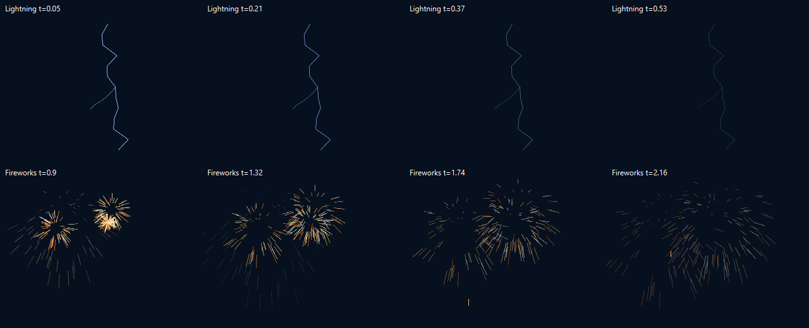
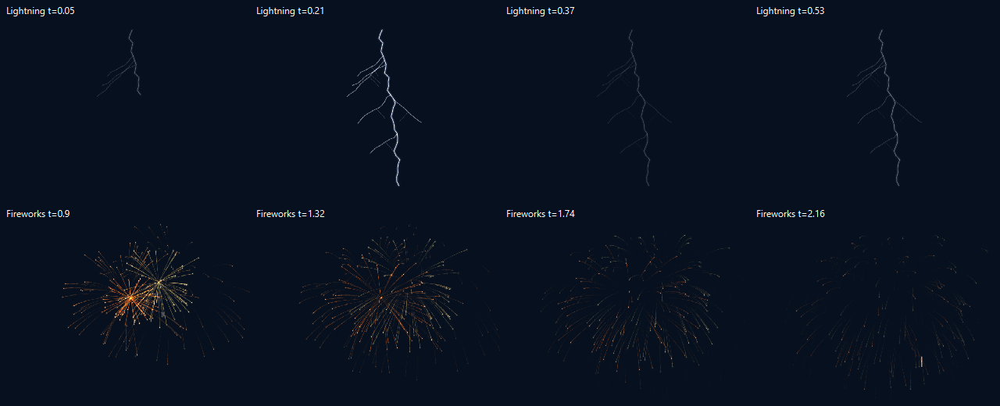

# Lightning and Fireworks visual review (2026-10-29)

The owner requested real-image comparison and authorized renderer improvements.
The references below were opened and visually inspected alongside native renders
at matched settings/times. They are research inputs, not application textures or
redistributed assets. Local originals are under `build/research/effect-references`.

## Sources and observation limits

| Reference | Resolution / capture | What it establishes |
| --- | --- | --- |
| [NWS / Marcelo Saba, slow-motion flashes](https://www.weather.gov/safety/lightning-science-slow-motion-flashes) | The page describes 4000 frames/s; its public GIF is 285 x 255 | Branching leader development followed by a bright return stroke; temporal evidence, not a high-resolution still |
| [Lightning branching and zigzagging, Scientific Reports](https://www.nature.com/articles/s41598-017-03686-w), Figure 1 | Inspected publisher figure, 675 x 921 | A brighter irregular main channel with finer, uneven side branches |
| [David Russell, Lightning](https://commons.wikimedia.org/wiki/File:Lightning_(22080153780).jpg) | 6000 x 3081, 20 s exposure, CC0 | Bright channel and surrounding luminosity; a long exposure integrates time and cannot establish frame-by-frame development |
| [Berit, Orange sparkle](https://commons.wikimedia.org/wiki/File:Orange_sparkle,_firework_that_is_really_amazing_(8282726074).jpg) | 4320 x 3240, 2 s exposure, CC BY 2.0 | Dense radial spread, curved luminous paths, hot cores and fading granular sparks |

The publisher article page could not be fetched through the web reader; its image
was downloaded directly and inspected. High-speed spatial resolution is lower
than the separate high-resolution photograph. No claim that a 6000-pixel image
was captured at 4000 frames/s is made.

## Before and after

The comparison uses one Lightning bolt and 240 Fireworks particles, the same seed,
palette, source bounds and absolute timestamps. It compares the renderer change,
not a denser preset. New Fireworks sources separately default to 320 particles;
existing saved counts are retained and the UI now accepts the existing 400 limit.

| Effect | Previous visible gap | Implemented response |
| --- | --- | --- |
| Lightning | Uniform twelve-segment line with one small fork; geometry simply faded | 36-segment irregular channel, bounded primary/secondary forks, growing leader, brighter core/halo and two return-stroke envelopes on stable seeded geometry |
| Fireworks | Short straight isolated strokes, independently colored sparks | Projected spherical spread, coherent burst color, analytic drag/gravity, ten tapered trail samples, hot heads and dim halos |

These are palette-driven RGB visualizations, not electrodynamic or pyrotechnic
simulations. Flash timing is intentionally readable at editor/LED frame rates,
not microsecond-accurate. Firework trails approximate a finite exposure; real
long-exposure photographs integrate much more light. No smoke, cloud illumination,
audio, real spark chemistry or variable launch system is claimed.

The new paths are bounded (at most 12 bolts, 400 sparks, ten samples per trail).
Absolute-time evaluation preserves seek/repeat/freeze behavior without simulation
state. Shared editor/service rendering uses the same implementation. Physical LED
brightness, timing and color reproduction require separate hardware observation.
