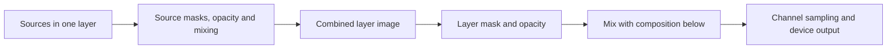

> Historical proposal from 2026-11-11. The GS-06-R2 implementation now distinguishes
> New layer (paint source) from New group (container), uses one selected-group/sibling
> rule for all effect families, and preserves existing files. See LIGHTING_EDITOR.md
> and UI_UX_AUDIT_2026-11-13.md for current behavior. The recommendations below are
> design history, not a statement that every proposed feature is implemented.

# Layer model proposal

Status: design proposal, not implemented. Prepared by Codex with bounded Claude
decision reviews for the owner's 2026-11-11 request. This document distinguishes
the current renderer from the proposed editing model. Existing projects are not
migrated or rewritten by the reliability fixes.

## Problem confirmed in the current code

`LightingDocument::addEmptyLayer()` creates a source-free container. The effect
creation handler in `LightingWindow` puts some sources into the active root, but
creates native patterns, Fireworks, Lightning and Starfield as independent roots.
Older source roots can also contain children. The tree labels these different
roles similarly. Consequently, the same apparent action can create an effect
inside a layer or create a new layer, depending on the effect type.

The renderer already supports isolated composition: compose a root's sources,
apply its mask and transparency, then mix it with the result of lower roots.
It supports Normal, Multiply, Screen and Overlay. It does not implement one
layer controlling another layer's speed, color or other parameters.

## Recommended model

One **Layer** is an ordered container. One **Effect** is a visual source inside
that layer: a pattern, particle source, shape, image or paint surface. Effects are
not called sublayers. A layer has no hidden visual source of its own.

```text
Layers                         Inspector
  Pulse highlights [Layer]     Layer: Pulse highlights
    White pulse    [Effect]    Mix with layers below: Screen
    Sparkles       [Effect]    Opacity: 60%
  Base color       [Layer]     Mask: enabled [thumbnail]
    Blue           [Effect]    Output: JARGB1

Top rows appear in front. The active destination is marked on its layer row.
```

### Creation and selection contract

| Action | Result |
| --- | --- |
| New layer | A new empty layer; selected and made the active destination. |
| Add effect to "Base color" | One new effect in that layer, regardless of effect type. The effect becomes selected. |
| Import image | One Image effect in the active layer. |
| No active layer in an empty document | Create one visible, neutrally configured layer and the requested effect in one undo step. |
| Select an effect | Inspect that effect; its owning layer becomes active. |
| Select a layer | Inspect its composition settings; new effects still go inside it. |
| Click empty canvas | Clear the selected effect, retain the visibly marked active layer. |
| Delete the active layer | Select the nearest surviving layer; if none survives, show no active destination. |
| Locked destination | Refuse insertion with a visible reason; do not bypass its editing lock or create another layer silently. |
| Hidden destination | Keep the explicit destination and show that its result is hidden; offer a separate Show layer action. |
| Selection spans several layers | Require one destination layer before insertion; never choose an arbitrary selected layer. |
| Pencil, Fill or Eraser in source mode | Edit a selected Paint effect; if none is selected, explicitly preview creation of a Paint effect in the active layer. |
| Shape/gradient creation tools | Create an effect in the active layer. Handles on an existing effect edit that effect. |
| Any drawing tool in mask mode | Edit only the selected effect/layer mask; never create another layer or effect. |

The Add action names its destination before the click. The inspector shows an
ownership path such as `Base color > Blue`. Creation and editing tools show their
operation, for example `Paint into Paint 1` or `Create Paint in Base color`.
An effect's source/geometry controls never edit siblings implicitly. Applying
motion to several effects remains an explicitly named, undoable action.
The default layer starts visible, unlocked, Normal, 100% opacity, with a white
mask and all software targets. It adds no independent clock: preview uses the
shared time, and channel sampling continues to use each channel's configured
clock. New children inherit that routing and evaluation context.

## What can influence what

| Control | Scope and visible result |
| --- | --- |
| Effect source, palette, geometry and motion | That effect only. No hidden parameter link to another effect or layer. |
| Effect opacity, mask and blend | Mix that effect with earlier effects inside the same layer. |
| Layer opacity and mask | Apply once to the already combined effects of that layer. |
| Layer blend | Mix the complete layer with the composition of lower layers. |
| Layer visibility | Hide the complete layer and its effects. Child visibility remains saved independently. |
| Layer output targets | All effects inherit these targets; show `Inherited from Base color` rather than editable ineffective child routing. |
| Playback and channel clock | Set the evaluation time. Sharing a clock does not create parameter links. |

Composition is feed-forward: lower layers cannot depend on upper layers, and no
layer feeds its output back into itself. The inspector uses the label
`Mix with layers below` for a layer and `Mix with effects below` for an effect.
Opacity is displayed as 0% invisible to 100% fully visible; existing stored
`transparency` values map as `opacity = 100 - transparency`.

The layers panel is front-to-back, the renderer evaluates back-to-front:



Groups are isolated. An effect's blend does not reach through its container and
alter effects in a different layer. The layer blend controls that interaction.
There is no group-wide geometric transform in this proposal; moving/rotating an
effect affects that effect. Layer ordering is separate from effect geometry.
The image composition starts transparent; device sampling treats uncovered
pixels as black. In particular, Multiply over transparent pixels retains source
coverage, rather than implying a solid black background in the image renderer.

### Explain the blends with a live result

| Mode | Plain-language help |
| --- | --- |
| Normal | Cover the result below wherever this layer has coverage. A full-opacity, full-canvas source can hide everything underneath. |
| Screen | Add light to the result below. Black preserves it; white reaches white. |
| Multiply | Darken overlapping coverage. White preserves the color below; black darkens it. |
| Overlay | Increase contrast using the color already below. Show the preview rather than promise a fixed brightness change. |

Transparent coverage remains transparent; black is a color, not an empty pixel.
Blend behavior is evaluated on RGBA images, not by multiplying hardware RGB bytes.
A single-layer blend preview must therefore show a background/composition below.

Example: put Blue in `Base color` and a white pulse in `Highlights`. Set
Highlights to Screen and reduce its layer opacity. The blue base remains visible
and brightens with the pulse. Switching Highlights to Normal with a full opaque
source demonstrates why the base can disappear. A layer mask then limits only
Highlights to one region; it does not cut a hole in Base color.

### Explicitly outside the first implementation

Live use of another layer as a mask, parameter modulation between layers,
feedback, adjustment layers, arbitrary nesting and pass-through group blends are
not current features and are not required for this model. Do not expose empty
controls for them. If requested later, design explicit named inputs, ownership,
cycle rejection and missing-source handling before adding them.

## Delivery in reviewable increments

1. **Clarify the current model first.** Label Layer versus Effect, show selection
   ownership and active insertion destination, explain blend scope and inherited
   routing, and add an in-app composition example. Label source-root projects as
   legacy rather than claiming the new creation model already applies to them.
   Show a legacy root's own source as an explicit bottommost `Own source` row,
   matching its current render order before its children.
2. **Make creation consistent.** Route every source, import and drawing path
   through one container-based creation contract. Remove effect-type exceptions.
   Verify menus, shortcuts, drag/drop, duplication and undo/redo together.
3. **Normalize legacy source roots safely.** Retain the existing loader and
   renderer until a separately reviewed migration preserves the root's own
   source, child order, source motion, animated masks, opacity, blending, routing,
   locks and references. Keep the original file and write a separately named
   converted copy. Do not flatten sources into an irreversible bitmap.
4. **Accept by interaction and rendered output.** Compare the live UI and saved
   projects against the scenarios below before promoting the design. Unit tests
   alone do not establish that the layer model is understandable to the owner.

### Acceptance matrix

- Add every supported effect type to an active nonempty layer: exactly one
  effect is added, the layer count is unchanged, and the displayed destination
  matches the saved parent. Import and creation tools follow the same rule.
- Empty document, empty layer and cleared selection: the destination is visible;
  creation is predictable and one undo restores the prior state. Multi-layer
  selection never chooses a destination silently.
- Overlapping red and blue sources: reorder, opacity 0/50/100, all four blends,
  and masks at black/gray/white produce the expected pixels inside and outside
  overlap. Check both transparent and opaque backgrounds.
- Two effects in a layer versus two independent layers: child blending remains
  isolated; a group mask/opacity applies once to the group result. Editing one
  effect does not change sibling parameters. Hiding a layer and showing it again
  preserves each child's independent visibility.
- Different output targets and channel clocks: a layer's effects inherit its
  effective routing; preview and sampled LEDs agree at the same evaluation time.
- Save/load and conversion: compare representative current/legacy frames at
  time 0, a fractional time, and a later animated time on each target channel.
  Check IDs/references and undo state; a mismatch blocks migration.
- Reject non-finite/out-of-range values, dangling or duplicate parent IDs,
  unsupported nesting and cycles atomically. Preserve the original document on
  rejection. The current 64-entry limit counts roots **and** child effects
  together, not 64 independent containers plus unlimited sources.

Owner review is needed before implementing this design. The reliability and logo
changes do not imply acceptance of this layer proposal.

## Feasibility evidence and resolved review points

Claude questioned whether the standalone-only creation rule was required by the
effect renderer. The creation handler's existing comment identifies avoidance of
an implicit masking parent as the reason. `EffectRenderer` has no parent/container
dependency. A new `neutralContainerPreservesStandaloneSources` test compares every
currently forced-standalone pattern, Fireworks, Lightning and Starfield as a root
versus a child of a neutral container at 0, 0.37, 2 and 86400 seconds. It passes
byte-for-byte in the Release test executable. This supports consistent creation
inside neutral containers; it does not prove arbitrary legacy migration or
non-neutral masks/blends. Those remain explicit acceptance gates.

Claude suggested allowing insertion into a locked layer with a warning. This
proposal instead preserves editing locks: insertion is disabled until the owner
unlocks it. Hidden layers can accept an explicitly targeted effect with a visible
hidden-state warning. This is a deliberate design choice, not a claim about a
newly implemented UI.
